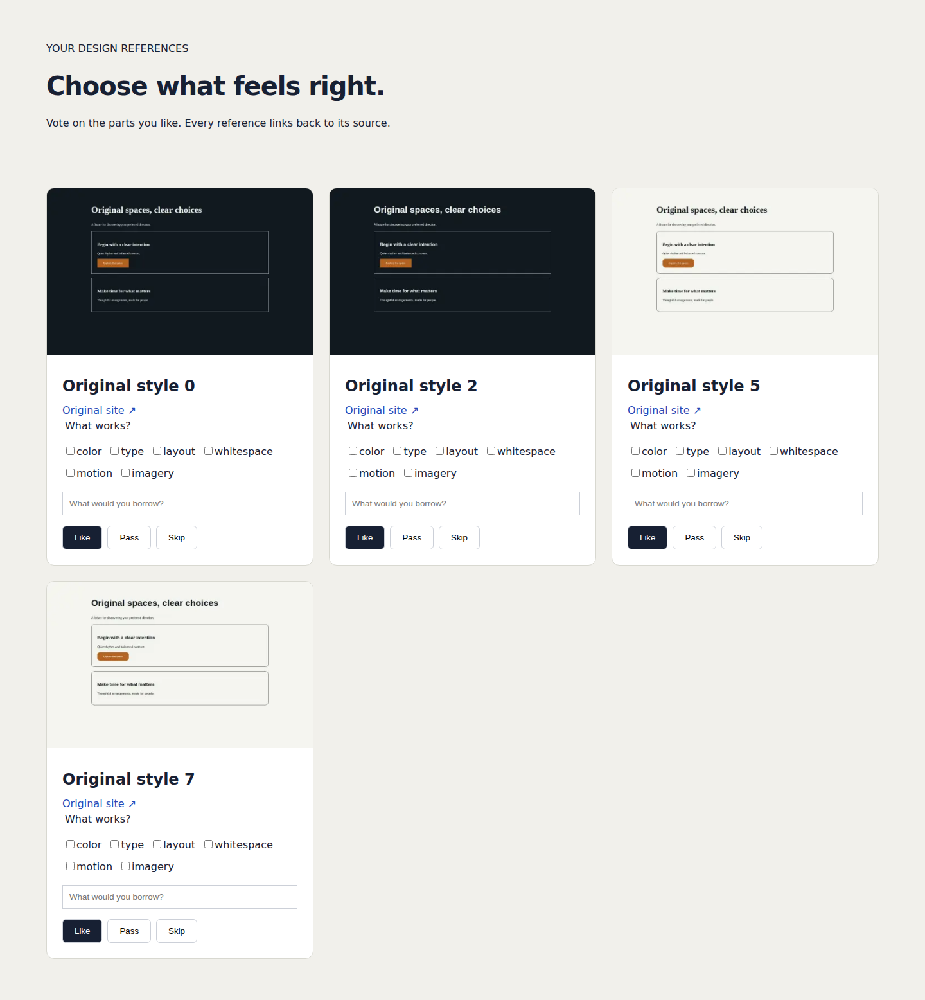
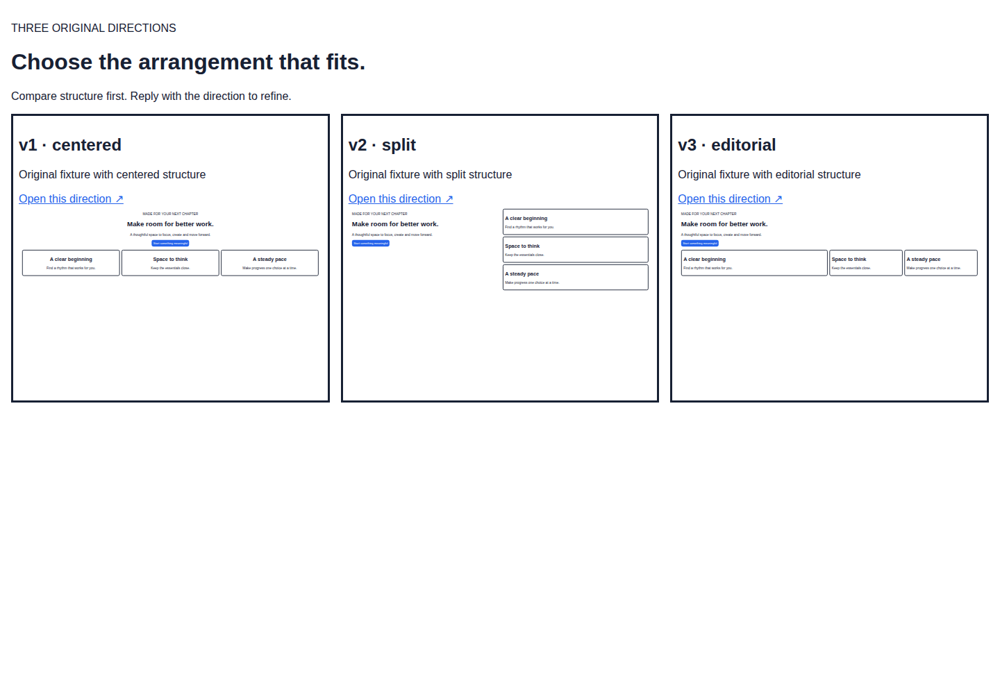
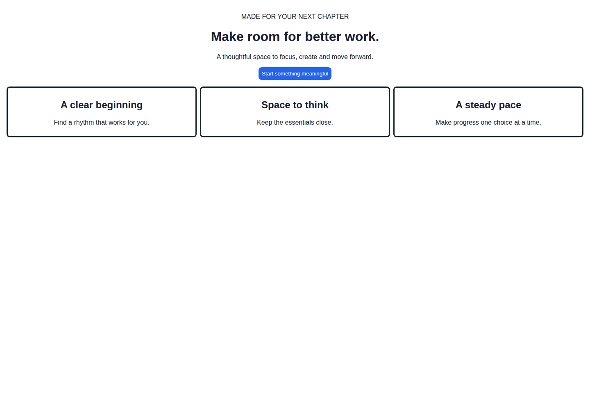
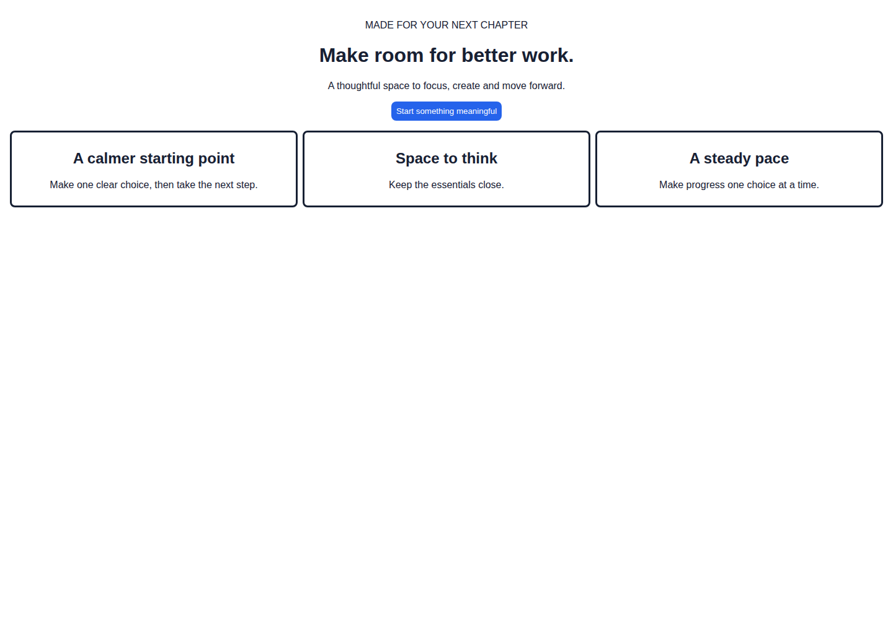

<p align="center">
  <picture>
    <source media="(prefers-color-scheme: dark)" srcset="docs/readme/banner-dark.png">
    
  </picture>
</p>

<h3 align="center">Turn the sites you love into a design system you can trace.</h3>

<p align="center">
  <a href="https://github.com/bmdy6/skill-design-from-sites/actions/workflows/ci.yml"></a>
  
  
  <a href="LICENSE"></a>
  <br>
  <a href="#quick-start"><b>Quick start</b></a> ·
  <a href="#how-it-works">How it works</a> ·
  <a href="SKILL.md">SKILL.md</a> ·
  <a href="docs/reference.md">Reference</a> ·
  <a href="README.zh-CN.md">中文</a>
</p>

<picture>
  <source media="(prefers-color-scheme: dark)" srcset="docs/readme/hero-dark.png">
  
</picture>

Highlighted source: [`color.accent` → `main.css:12`](test/fixtures/site-a/main.css#L12).

## Quick start

```sh
npx skills add bmdy6/skill-design-from-sites
```

Then tell your agent:

> Use design-from-sites. Here are two sites whose feel I like: `<url-1>` `<url-2>`. Help me pin down my taste and draft a landing page.

<sub>Node ≥ 20 · no API key · no hosted service · runs locally with Playwright + Chromium</sub>

## How it works

<p>1. Vote on references</p>


<p>2. Compare three layouts</p>


<p>3. Circle and revise</p>



Your taste comes first, tokens second, code last. Every step waits for an explicit "yes" from you.

## Why design-from-sites

- **Tokens with receipts.** Every color, size, radius and shadow keeps its selector and stylesheet `line:column`. After building, the skill reopens the page and re-checks a sample of sources.
- **The model names, it never invents.** Numbers come from measured evidence. The agent only maps names to evidence IDs that already exist, and an unknown ID fails the build.
- **Nothing copied.** Image, font, logo, SVG and video requests are blocked during collection. Previews use original placeholders and local Lucide icons.

## Comparison

| | What it focuses on | How this project differs |
|---|---|---|
| dembrandt | Brand extraction and token export | Its own Playwright/CDP collector, which records selector and line/column |
| getdesign / design.md | Design docs for agents | Evidence and names are kept apart, and sources are re-verified |
| superdesign | Exploring multiple design options | Local pages and explicit approval gates, with no hosted service |

## Try it without an agent

```sh
git clone https://github.com/bmdy6/skill-design-from-sites && cd skill-design-from-sites
npm ci
node scripts/doctor.mjs --json     # installs Chromium if missing
node scripts/run.mjs extract --url https://example.com --out .design-from-sites
```

`extract` measures the page at desktop and mobile widths, then stops at `.design-from-sites/next.json`, where an agent takes over. Once tokens exist, you can lint your own CSS against them:

```sh
node scripts/check.mjs --tokens .design-from-sites/tokens.json --paths src --format json
```

Each off-token value is reported with its `file:line`, the nearest token and a `var(--…)` replacement. Exit code 1 means there are findings.

## Personal and company mode

- **Personal** (`--mode personal`): at most five questions, then taste → tokens → drafts.
- **Company** (`--mode company`): your existing page or code is the baseline. External inspiration is off by default, wireframes can't be skipped, and owner preferences come only from you.

All commands, gates and exit codes are in the [reference](docs/reference.md). To contribute, run `npm test`. To rebuild the README images from fixtures, run `node scripts/readme-art.mjs`.

---

<p align="center"><sub>MIT License · Only collects public pages and copies no logos, fonts or images · <a href="docs/reference.md#copyright-and-trademark-not-legal-advice">Copyright and trademark note (not legal advice)</a></sub></p>
