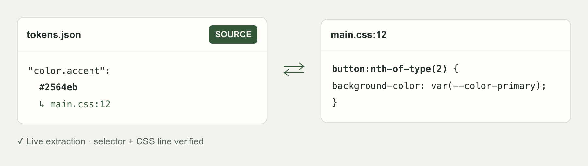
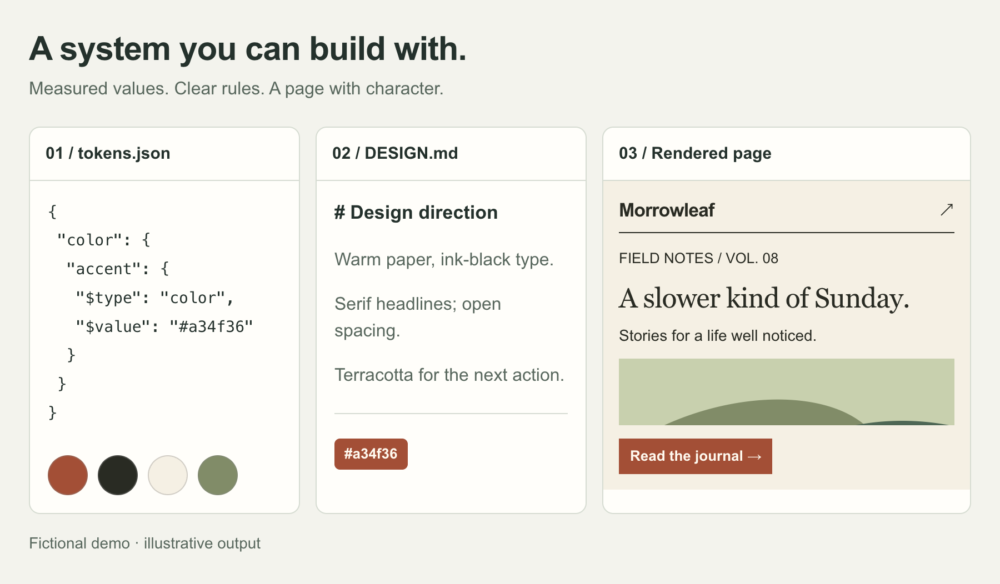
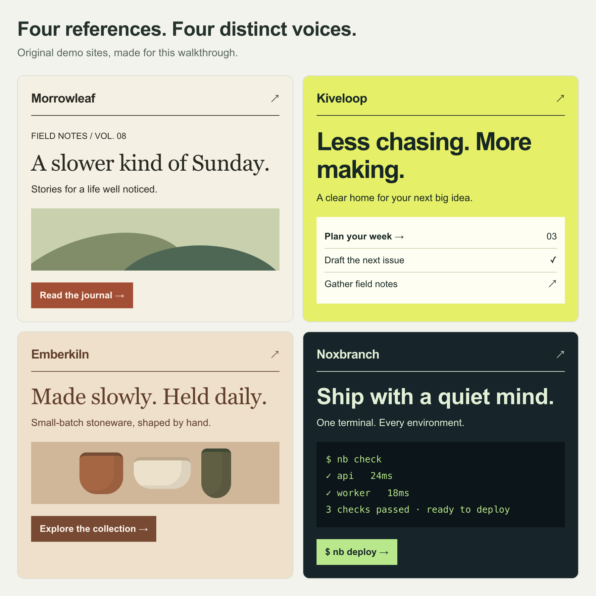
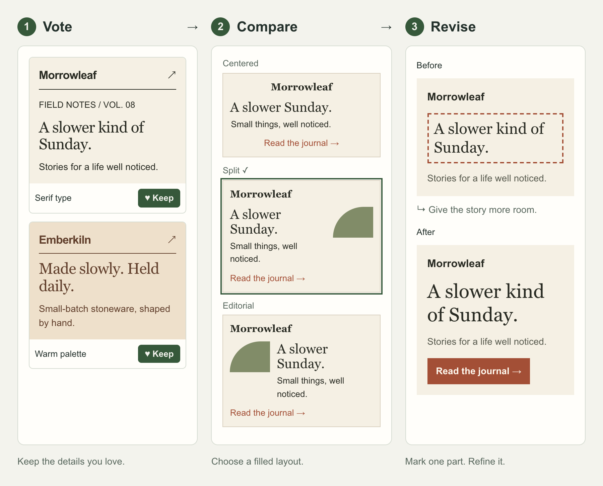

# skill-design-from-sites

Extract design tokens you can trace to a selector and CSS line.

[](https://github.com/bmdy6/skill-design-from-sites/actions/workflows/ci.yml)
[](LICENSE)
[简体中文](README.zh-CN.md)

<picture>
  <source media="(prefers-color-scheme: dark)" srcset="docs/readme/hero-dark.png">
  
</picture>

Live extraction, verified CSS source.

## What you get

<picture>
  <source media="(prefers-color-scheme: dark)" srcset="docs/readme/showcase-dark.png">
  
</picture>

Fictional demo: tokens, rules, rendered page.

<picture>
  <source media="(prefers-color-scheme: dark)" srcset="docs/readme/samples-dark.png">
  
</picture>

Four styles to explore your taste.

## Quick start

```sh
npx skills add bmdy6/skill-design-from-sites
```

Tell your agent:

> Use design-from-sites with `<url-1>` and `<url-2>`; draft a page.

## How it works

<picture>
  <source media="(prefers-color-scheme: dark)" srcset="docs/readme/workflow-dark.png">
  
</picture>

Vote → Compare → Revise, with your approval.

## Traceability in 10 lines

`sources.json` example; lines require accessible stylesheets.

```json
{
  "color.accent": {
    "value": "#a34f36",
    "evidence": [{
      "selector": ".cta",
      "stylesheet": "https://journal.example/main.css",
      "line": 42
    }]
  }
}
```

## Commands / options

[Command reference](docs/reference.md) · [Agent workflow](SKILL.md)

| Command / option | Result |
|---|---|
| `extract --url <url> --out <dir>` | Measure; hand off at `next.json` |
| `tokens --out <dir>` | Build from labeled evidence |
| `--mode personal` / `--mode company` | Explore / preserve baseline |
| `scripts/check.mjs --tokens <file> --paths src` | Find off-token CSS values |

## FAQ / limitations

- Runtime ≥ 20; local, no API key.
- Only collects public pages; copies no logos, fonts or images. [Copyright and trademark (not legal advice)](docs/reference.md#copyright-and-trademark-not-legal-advice).
- Unknown evidence IDs fail the build.
- Company mode: existing baseline, external inspiration off.

## License

[MIT](LICENSE).
