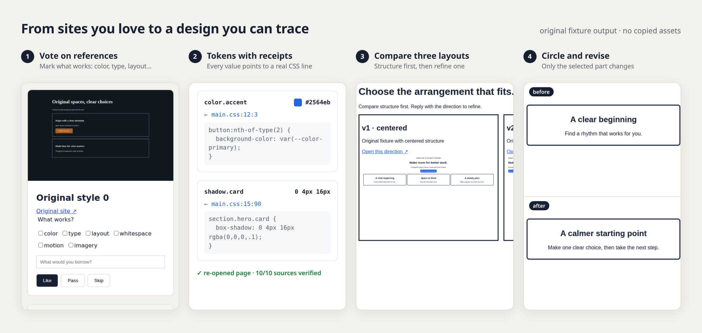

# design-from-sites

**把你喜欢的网站，变成一套能追溯出处的设计规范。** 这是一个 agent 技能：先通过投票摸清你的审美，再从参考页面提取设计 token，每个值都能追到它来自哪一行 CSS。

[](https://github.com/bmdy6/skill-design-from-sites/actions/workflows/ci.yml) [](LICENSE) · [English](README.md)



```sh
npx skills add bmdy6/skill-design-from-sites
```

然后对你的 agent 说：

> 用 design-from-sites。这两个网站的感觉我喜欢：`<网址1>` `<网址2>`。帮我摸清审美，出一版落地页。

需要 Node ≥ 20，不需要 API key，没有托管服务，全部用 Playwright + Chromium 在本地运行。

## 为什么用它

- **token 有出处。** 每个颜色、字号、阴影都记录了 selector 和样式表的 `行:列`；生成后会重新打开页面，抽样复核来源。模型只负责命名，而且只能引用已有的证据 ID，没法编造数值。
- **先定审美，再出 token。** 先投票选出哪里好看（颜色、字体、布局、留白……），确定后才开始提取；接着对比三种布局，选一个，再圈出要改的那一处。每一步都要你明确点头。
- **不复制素材。** 采集时拦截图片、字体、logo、SVG 和视频；预览只用原创占位块和本地 Lucide 图标。

## 与已有项目的区别

| | 侧重 | 本项目 |
|---|---|---|
| dembrandt | 品牌提取与 token 导出 | 自己用 Playwright/CDP 采集，记录 selector 和样式表行列，没有复用其实现 |
| getdesign / design.md | 给 agent 用的设计文档 | 数值证据和语义命名分开存放，来源会重新核对 |
| superdesign | 多方案的交互探索 | 用本地页面加显式 gate，不依赖托管服务 |

## 不装 agent 也能试

```sh
git clone https://github.com/bmdy6/skill-design-from-sites && cd skill-design-from-sites
npm ci
node scripts/doctor.mjs --json     # 缺 Chromium 时自动安装
node scripts/run.mjs extract --url https://example.com --out .design-from-sites
```

`extract` 会在桌面和手机两个宽度下测量页面，然后停在 `.design-from-sites/next.json`；之后由宿主 agent 写 labels，再由技能生成 token。完整的 agent 流程见 [SKILL.md](SKILL.md)，全部命令、gate 和退出码见[参考手册](docs/reference.zh-CN.md)。

有了 token 之后，可以拿它检查你自己的代码：

```sh
node scripts/check.mjs --tokens .design-from-sites/tokens.json --paths src --format json
```

每个偏离 token 的值都会附上 `文件:行`、最接近的 token 和一个建议的 `var(--…)` 替换；有发现时退出码为 1。

## 个人模式和公司模式

- **个人**（`--mode personal`）：最多问五个问题，然后依次定审美、出 token、出设计稿。
- **公司**（`--mode company`）：以现有页面或代码为基准，外部灵感默认关闭，不能跳过线框；老板偏好只能由你提供。

详见[参考手册 → 两种模式与批准](docs/reference.zh-CN.md#两种模式与批准)。

## 范围与权利

只采集公开页面；不会读取登录态、cookie、浏览器原有 profile、agent 记忆或内部系统。每次只测一个页面的两个视口，不爬整站。

<details>
<summary>版权和商标说明（非法律意见）</summary>

提取公开页面的计算样式，不意味着获得设计、商标、图片或字体的使用授权。请自行确认目标页面的使用条款与适用规则。不复制 logo、文案、图片、字体文件和完整页面；对外材料只放来源链接、自己的说明和 CSS 色块。详见[参考手册](docs/reference.zh-CN.md#版权和商标说明非法律意见)。

</details>

## 参与开发

运行 `npm test` 跑全部测试（node:test），浏览器测试需要能启动 Chromium 的环境。仓库里的图片全部来自原创 fixture，可以用 `node scripts/screenshots.mjs` 和 `node scripts/readme-hero.mjs` 重新生成。

MIT，见 [LICENSE](LICENSE)。
