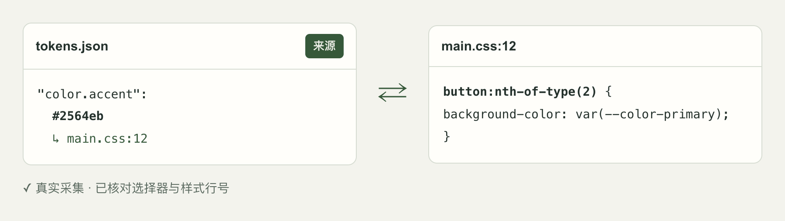
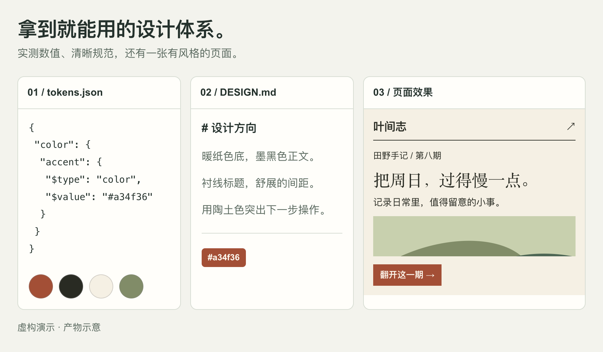
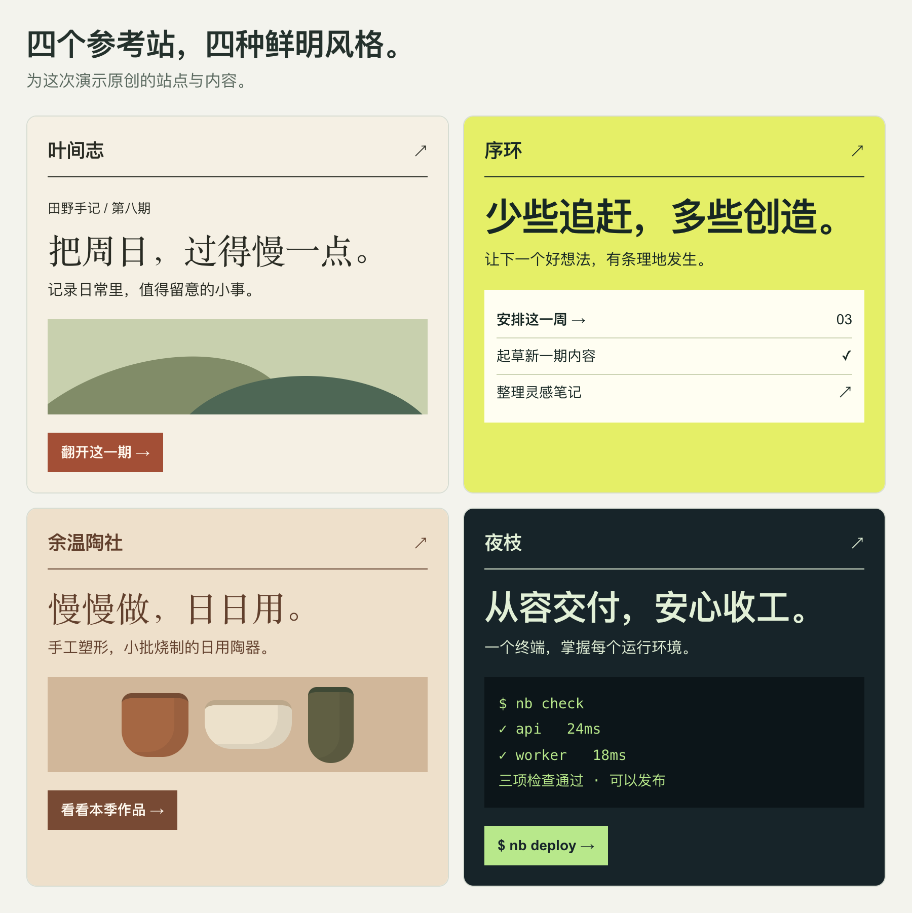
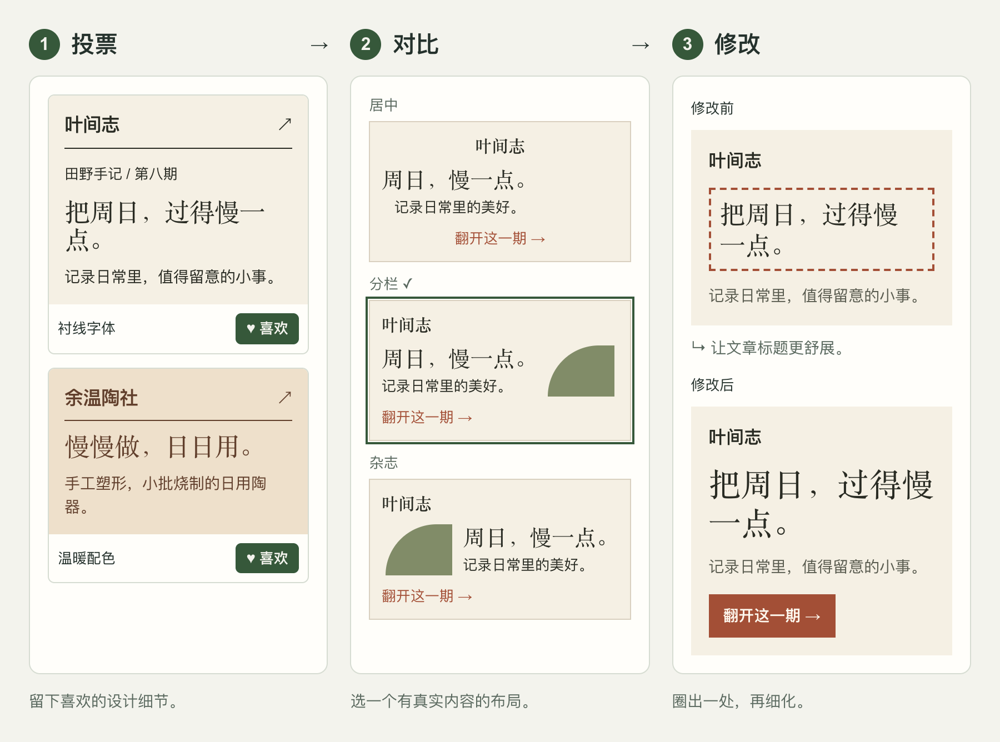

# skill-design-from-sites

从喜欢的网站提取设计 token，每个值都能追溯到选择器与 CSS 行号。

[](https://github.com/bmdy6/skill-design-from-sites/actions/workflows/ci.yml)
[](LICENSE)
[English](README.md)

<picture>
  <source media="(prefers-color-scheme: dark)" srcset="docs/readme/hero-dark.zh-CN.png">
  
</picture>

真实采集并复核的 token → CSS 来源。

## 快速开始

```sh
npx skills add bmdy6/skill-design-from-sites
```

告诉 agent：

> 使用 design-from-sites，以 `<url-1>` 和 `<url-2>` 为参考，帮我确认偏好并起草一个页面。

## 你会得到什么

<picture>
  <source media="(prefers-color-scheme: dark)" srcset="docs/readme/showcase-dark.zh-CN.png">
  
</picture>

虚构演示：实测 token、设计规范，以及供你选择的页面草稿。

<picture>
  <source media="(prefers-color-scheme: dark)" srcset="docs/readme/samples-dark.zh-CN.png">
  
</picture>

四种原创风格，用来探索配色、字体与布局偏好。

## 工作流程

<picture>
  <source media="(prefers-color-scheme: dark)" srcset="docs/readme/workflow-dark.zh-CN.png">
  
</picture>

投票 → 对比 → 修改；每一步都等你确认。

## 十行看懂来源追溯

`sources.json` 示例；可用行号取决于样式表是否可访问。

```json
{
  "color.accent": {
    "value": "#a34f36",
    "evidence": [{
      "selector": ".cta",
      "stylesheet": "https://journal.example/main.css",
      "line": 42
    }]
  }
}
```

## 命令与选项

命令细节见[参考文档](docs/reference.zh-CN.md)，协作流程见 [SKILL.md](SKILL.md)。

| 命令 / 选项 | 用途 |
|---|---|
| `extract --url <url> --out <dir>` | 采集，停在 `next.json` 等待 agent 命名 |
| `tokens --out <dir>` | 从已标注的证据生成 token |
| `--mode personal` / `--mode company` | 探索偏好 / 以现有设计为基准 |
| `scripts/check.mjs --tokens <file> --paths src` | 查找偏离 token 的 CSS 值 |

## 常见问题与限制

- 需要运行时版本 ≥ 20；本地运行，无需 API 密钥。
- 只采集公开页面；不复制商标、字体或图片。查看[版权和商标说明（非法律意见）](docs/reference.zh-CN.md#版权和商标说明非法律意见)。
- Agent 只为已有证据命名；未知证据 ID 会使构建失败。
- 公司模式默认关闭外部灵感；已有页面或代码是基准。

## 许可证

[MIT](LICENSE).
